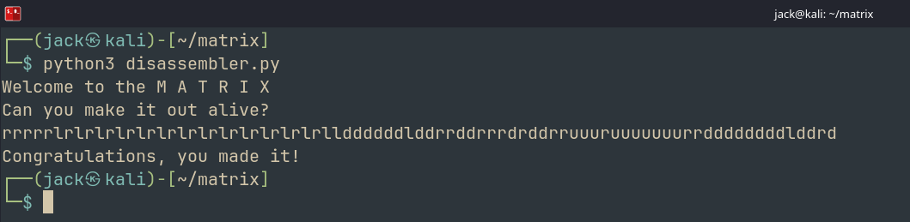

# MATRIX
## Challenge: <https://learn.cylabacademy.org/library/221>

Hello Hackers! 

Welcome back to another writeup. Today we will be looking at MATRIX from picoCTF. 

This challenge was suggested to me by my good friend [mooofin](https://mooofin.github.io/portfolio/index.html). He does some really cool stuff so you should definitely check his work out. 

Moving on to the challenge, it is `hard` rated so let's see what we are dealing with. 

The challenge description wasn't much help. 

> Enter the M A T R I X

Huh? 😭😭

Okay so let's just download the binary and start our initial analysis. 

`matrix: ELF 64-bit LSB pie executable, x86-64, version 1 (SYSV), dynamically linked, interpreter /lib64/ld-linux-x86-64.so.2, BuildID[sha1]=d315f81ec0acba26601bed3ac8b6f6ead3a376ad, for GNU/Linux 4.4.0, stripped`

So this is what we are dealing with. 

Running `strings` gave us a useful piece

```
Have a flag!
flag.txt
```

This will help us when we use `ghidra`. 

Let's try to just run the binary.

```
Welcome to the M A T R I X
Can you make it out alive?
AA
You were eaten by a grue.
```

Okay so we need to figure out which input will get us the flag. 

So without waiting much longer, lets start analysing the file using `ghidra`. 

Tracing the function calls from the beginning, we reach a particularly interesting function. It is clear, this is a custom VM. 

We have a lot of opcodes to map. It is not very beneficial to explain each opcode in the writeup but I will explain a general procedure. 

Simply, what a custom VM means is that the program is trying to run a mini computer of its own inside, instead of executing like a normal binary. This is a very common practice for obfuscating code and making lives harder for reverse engineers like us. 

Basically we will be able to trace a big blob of bytecodes, and our program iterates through these. Each of them has a special meaning. And the program basically only tells us what to do when a specific bytecode is encountered. 

Being able to read assembly is a very essential skill you need to be able to properly map each of these. 

What i recommend is connecting your decompiler to a debugger. (i worked with ghidra + gdb)
Set a break point for the first opcode, observe the registers as the execution continues, and simply repeat this until you have successfully mapped all the opcodes. Along with mapping each opcode, you need to write a python equivalent of it so we can mimic what the binary is really doing. Python is usually the best option for most people. (including me)

I have written and attached a full disassembler.py along with this writeup. It has some missing opcodes, but that was because our flow of execution never encounters those, and hence its a waste of time to map those; but its worth knowing. 

When i tried running the disassembler.py, voila! we mimic the binary. We get the welcome prints and also the 'eaten by a grue' message. 

What i also did for each opcode is that i made it write the instruction to file called `assembly` which is attached here as well. Mind you, this is not an exact assembly file with the correct syntax and all. It is just my implementation to understand whats really going on in the VM. 

The next part is just reading the assembly file and understanding whats happening. 

The beginning of the file is all the printing logic. 

Let's find `GETC` so we can find what happens AFTER the input is taken.

The first finding is that only one character is pushed. 

```asm
GETC
PUSH a
PUSH 0x61
PUSH 0x75
SUB 0x61 0x75
POP <0x750061>
PUSH 0xffec
PUSH 0xa0
POP <0xa0>
PUSH 0x61
PUSH 0x64
SUB 0x61 0x64
POP <0x640061>
PUSH 0xfffd
PUSH 0xaa
POP <0xaa>
PUSH 0x61
PUSH 0x6c
SUB 0x61 0x6c
POP <0x6c0061>
PUSH 0xfff5
PUSH 0xb4
POP <0xb4>
PUSH 0x61
PUSH 0x72
SUB 0x61 0x72
POP <0x720061>
PUSH 0xffef
PUSH 0xc0
POP <0xc0>
PUSH 0xfb
```

We can clearly see interesting SUB commands: `0x75` `0x64` `0x6c` & `0x72` which directly correspond to ASCII `u`, `d`, `l` & `r`. 
That is a very good find. It is navigation of some sort. Let's read further. 

Our next observation is that 0xfb means we're done. It is the `JMP` that prints the grue text.

Okay, so since we know what the legal inputs are, lets try using them to see how our assembly file changes. 

Lemme try using `lrud`

Nothing changed? Lets use `ruld`. 

BOOM- the file got bigger. A second GETC can be seen. Thats interesting. so we can now be almost sure that the first move is `r`.

The question that sparked my mind is, can i make a script that does this? try each combo for observing change in the file size to basically brute force the input? 

Okay that didn't work as I expected, but i want you to figure out why, as soon as youre done reading this. Let it be a fun lil homework :)

So, since we know as soon as `PUSH 0xfb` happens, we lose, lets see what happens just before that. 

Hmm interesting

```asm
PUSH 0x174
ADD 0x40 0x174
POP <0x1740040>
PUSH 0x1b4
POP <0x1b4>
JMP 0x1b4
PUSH 0xfb
```

A few offsets, `0x174`, `0x1b4`, etc. Lets inspect our bytecode to see what lies here. 

We see smtg very interesting when we go to `0x174`

A repeating pattern, in the multiples of 4. And this pattern continues for 1024 bytes. With all the data we have, ie, the lrud instructions, and 1024 bytes, it is clear. We are dealing with a maze, and the maze is located at the offset 0x174 in the bytecode.

The bytecodes in that region, I saved and attached along (`mazehex`)

Since its a maze, we can assume its dimensions. Since each block is 4 bytes, it gives us total of 1024/4 = 256 blocks. Assuming the most plausible combination, it is a 16x16 maze. This is purely a guess, you can try stuff like 32x8, etc. But 16x16 is what i chose. 

Lets write a small python script that prints this in a clean form. We can observe 5 unique blocks. I just named them A, B, C, D and E at first, just to see what we were working with. And BOOM. It was a proper maze, with walls, end point and walkable spaces. BUT it still had two interesting blocks, which i didnt know what they did. 

Again, interesting. Let's try to understand whats happening, which is not very hard because of our disassembler. We could just put in the directions to go to each of those and see whats changing in our assembly. 

We quickly realise that we might be working with a factor, `health`. To solve the maze using the shortest route, we passed through the special block 5 times, and it can be inferred that our player health is not that much. So this automatically tells us what the other special block does, it increases the health. 

Let's just try to spam the health+ and then go on solving the maze? 

`rrrrrlrlrlrlrlrlrlrlrlrlrlrlrlrllddddddlddrrddrrrdrddrruuuruuuuuuurrddddddddlddrd`

Voila! We got the congratulations print



Well the challenge is already solved, but lets try reducing the number of `lr` until we die. 

With trial and error, we can conclude that 

`rrrrrlrlrlrlrllddddddlddrrddrrrdrddrruuuruuuuuuurrddddddddlddrd`

is the least `lr` spam way to win. (exactly visiting the health+ 5 times!)

What this tells us?

> We are dealing with a 16x16 maze, along with a player health constraint. Assuming the initial health to be 1, when the health reaches 0, the player dies. On our way to solve the maze, we encounter the health- block exactly 5 times. So to win, we need to visit health+ 5 times before we start our journey to the end. Since health+ is available at multiple locations, there are more than one ways to win this. This is just my version. You are more than welcome to experiment with your own solutions. 

Lets now submit this to the remote server and boom :)) we have successfully completed this challenge. 

This was definitely a very very fun challenge. Even though picoCTF challenges are known to be more on the easier side, this one definitely made me work. I took multiple days to solve it, especially because of the custom VM (which was probably the biggest takeaway from this challenge) and also the fact that this type of challenges are not very commonly seen. 

I hope you learnt a thing or two from this writeup, because I surely did. 

I will see you soon with another article, until then,

Happy Hacking! 